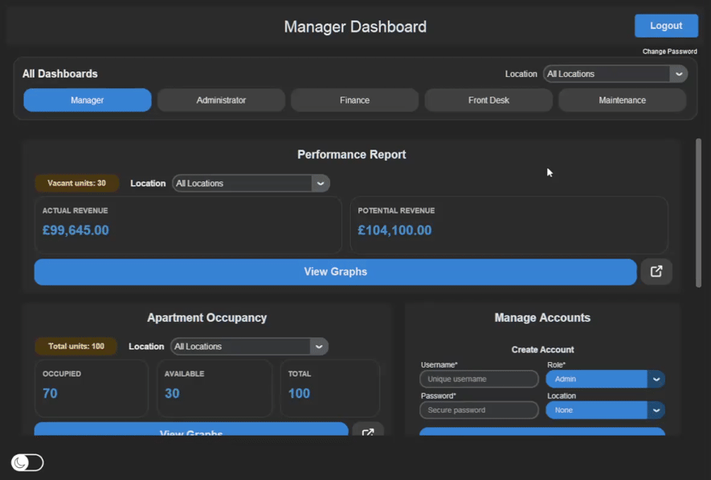
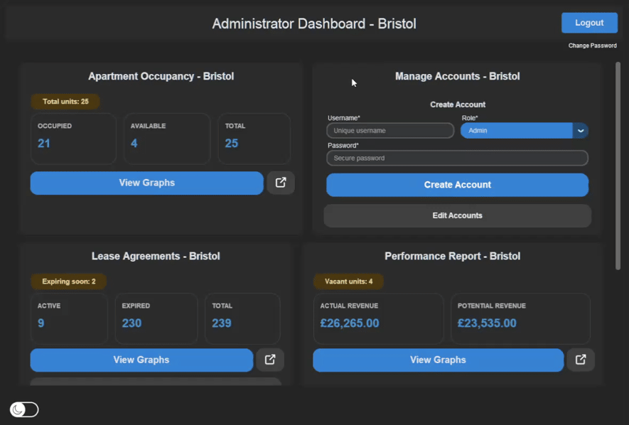
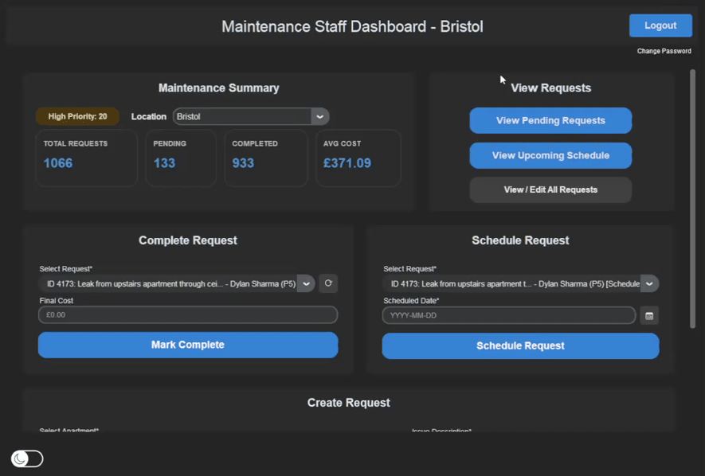
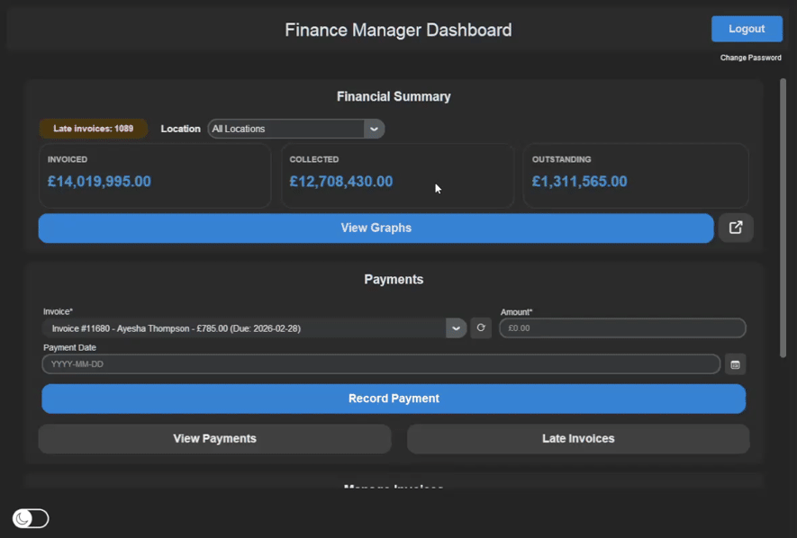
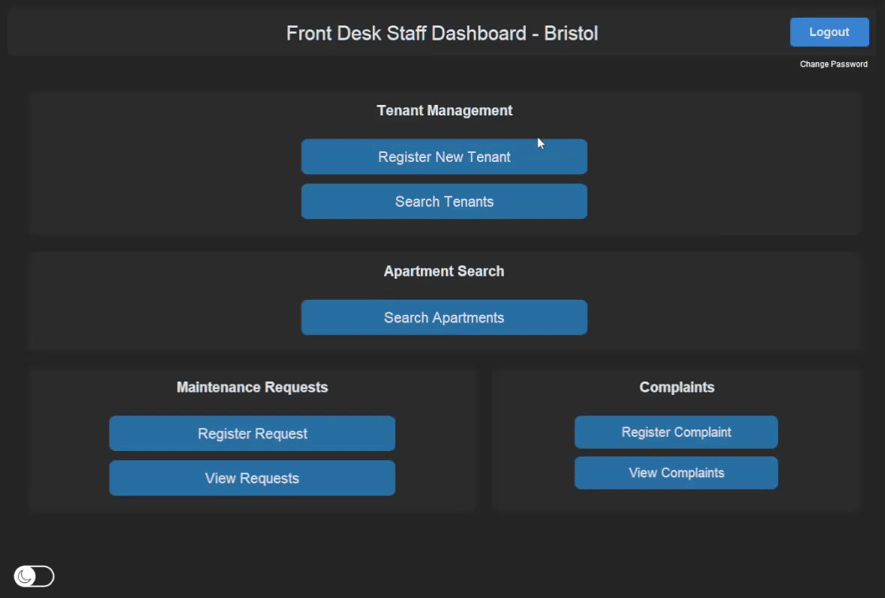

# Paragon Apartments Management System

A desktop application for managing a multi-location apartment business, bringing tenant records, property management, maintenance, billing and financial reporting into one centralised system.

Developed by a five-person team at the University of the West of England (UWE Bristol) for the **Advanced Software Development Group Project** module.

## Demo

PAMS provides role-specific interfaces for managing day-to-day apartment operations, from registering tenants and tracking maintenance requests to reviewing financial performance across multiple locations.

### Manager Dashboard

*Monitor operations across Bristol, Cardiff, London and Manchester, with access to management information and all other dashboards.*

### Administrator Dashboard

*Manage user accounts and monitor operations for a single location.*

### Maintenance Dashboard

*Record maintenance issues, manage priorities and track requests through to resolution, including associated costs and time taken.*

### Finance Manager Dashboard

*Review financial summaries and generate graphical reports to compare collected and outstanding rent across locations.*

### Front Desk Dashboard

*Manage tenant records, apartment assignments, lease agreements and complaints through the application's graphical interface.*

## Key Features

- **Role-based access:** Separate interfaces and permissions for Managers, Administrators, Finance, Front Desk and Maintenance staff.
- **Multi-location management:** Manage apartment operations across four cities from a centralised application.
- **Tenant and lease management:** Maintain tenant records, apartment assignments, lease information, complaints and payment history.
- **Property management:** Register apartments, manage property details and monitor occupancy.
- **Maintenance tracking:** Log issues, manage priorities and record resolutions, costs and time taken.
- **Billing and payments:** Generate invoices and receipts, record simulated payments and identify overdue rent.
- **Financial reporting:** Generate graphical reports and statistics to support operational and financial decision-making.

## Project Overview

The application was designed around the operational requirements of a multi-location apartment management company. A centralised SQLite database stores the system's records, while role-based access helps ensure users interact with the functionality relevant to their responsibilities.

The project was developed iteratively using the **Rational Unified Process (RUP)**, supporting collaboration, incremental development and refinement of requirements throughout the project lifecycle. GitHub branches were used to develop individual components before integration.

### My Contributions

As part of the five-person development team, I was responsible for:

- Developing the **Manager and Administrator interfaces**.
- Designing the application's overall file structure and base architecture.
- Creating reusable page components to support a modular application structure.
- Implementing graphical reporting features, including the export of graphs and statistics.

Other team members contributed to the Finance, Front Desk and Maintenance components, alongside shared testing, debugging and interface refinement.

## Setup and Usage

### Installation

1. Clone the repository:

   ```bash
   git clone https://github.com/Aaron-Antal-Bento/paragon-apartments-management-system.git
   cd paragon-apartments-management-system
   ```

2. Run the setup script from the `setupfiles` directory.

   **Windows (PowerShell)**

   ```powershell
   cd setupfiles
   powershell -ExecutionPolicy Bypass -File .\setup.ps1
   ```

   **Linux/macOS**

   ```bash
   cd setupfiles
   chmod +x setup.sh
   ./setup.sh
   ```

The setup script creates a Python virtual environment, installs the required dependencies and initialises the SQLite database with mock data.

### Launch the Application

From the project root, run:

```bash
python paragonapartments/main.py
```

If the virtual environment was created successfully, activate it before launching the application if necessary.

## Demo Login Credentials

Use the following accounts to explore the different role-specific interfaces.

| Username | Password | Role | Access scope |
|---|---|---|---|
| `manager` | `paragon1` | Manager | All locations |
| `finance` | `finance1` | Finance | Financial operations |
| `bristol_admin` | `admin1` | Administrator | Bristol |
| `bristol_frontdesk` | `front1` | Front Desk | Bristol |
| `bristol_maintenance` | `maint1` | Maintenance | Bristol |

Equivalent seeded accounts are available for Cardiff, London and Manchester. Replace `bristol` in the username with the relevant city and use the password associated with the role.

For example, `london_frontdesk` uses `front1`.

## Database Utilities

The SQLite database is stored at:

`paragonapartments/database/paragonapartments.db`

Two utility scripts are provided for preparing the database.

**Generate the full mock dataset**

```bash
python setupfiles/tools/create_sqlite_testdata.py
```

This script replaces the existing database with the test dataset.

**Create an empty database with minimal seed data**

```bash
python setupfiles/tools/create_empty_sqlite_db.py
```

This creates the database schema with four locations and a manager account.

## Technology Stack

| Technology | Purpose |
|---|---|
| Python | Application logic and backend functionality |
| CustomTkinter | Desktop graphical user interface |
| SQLite | Persistent relational data storage |
| Matplotlib, NumPy and SciPy | Graphical reporting and supporting numerical operations |
| Pillow | Image handling |
| Passlib | Password hashing utilities |
| tkcalendar | Calendar-based date selection |

## Project Documentation

This project was developed by: Nickolas Greiner, Aaron Antal-Bento, Oliver Mercer, Oliver Churchley, and Ahmed AlShamy.

The repository includes supporting project documentation covering requirements, design, implementation, testing and the development methodology.

| Resource | Description |
|---|---|
| [Methodology Report](documentation/Methodology.pdf) | Overview of the Rational Unified Process (RUP), system requirements, development methodology and team contributions |
| [Design Diagrams](<documentation/System Design Diagrams.pdf>) | Class diagrams, database schema, use case diagram, and sequence diagrams |
| [Testing Documentation](<documentation/Testing Document.pdf>) | All test cases and results |

## Important Notes

- The application uses mock data for demonstration and testing.
- Billing functionality simulates transactions; it does not process real payments.
- The application is a university group project and is intended as a demonstration of software design and development.
